## Why this one is different

The previous four parts had a shape: here is a seam in the platform, here is the confusing
bug it caused, here is what we did about it. This part does not fit that shape, because the
assistant is not a seam we patched, it is a thing we chose to build once the platform
underneath it was solid enough to trust. So the register changes. Less "here is the scar," more
"here is what the scars made possible."

It is also unfinished. The first version of this post said so, and admitted that its
evaluation could not measure the part we were proudest of. That gap is closed now, and closing
it changed the product: where it runs, how it reads logs, which model drives it, and what we
promise about where data goes. An assistant that diagnoses failures has no business pretending
its own story is tidier than it is, so this version includes the places where the numbers told
us we were wrong.

## What it actually does

It answers two kinds of question for the people who build and run the platform. The first is
"how does this codebase work," answered with grounded, cited responses drawn from every repo's
docs, the knowledge-transfer transcripts, the architecture decks, and a structural map of every
source file. The second, and the one we care about most, is "why did my job fail," answered not
by restating the error but by checking the real evidence: the run's own error and cluster logs,
in any of our six workspaces, the model's real config, the app logs, and the source file named
in the traceback. Questions about numbers, "how often has this job failed," are handed to
Databricks Genie.

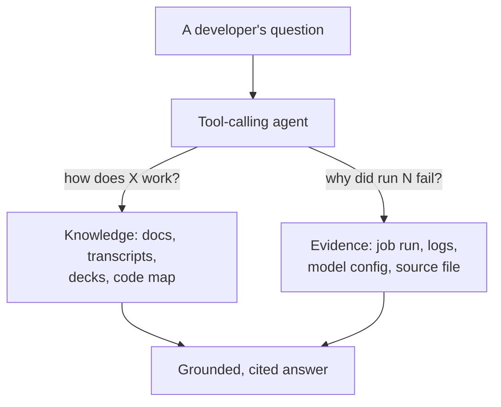

The second question is the one with teeth, because a wrong diagnosis is worse than a hedge. If
someone asks why their run failed and the assistant confidently names the wrong cause, it has
actively made their afternoon worse. That single fact, a wrong "why" is worse than an honest "I
am not sure," drove most of the design decisions below.

## Why a notebook, not an App

A series about Databricks Apps should probably end with an App. This one does not, and the
reason is the identity story from part one. Diagnosing a run means calling the Jobs API and
reading cluster logs from a Unity Catalog Volume, as the person asking. On-behalf-of auth in
Apps and in Model Serving does not cover those scopes today, and the only way around that is a
service principal, which would see everyone's runs. That is the one thing we refused to build.

A notebook already has the user's identity. So the assistant is a Python package, published as
a wheel to a Volume by an asset bundle and loaded as a notebook magic:

```python
%mml why did run 124337049826774 fail?
```

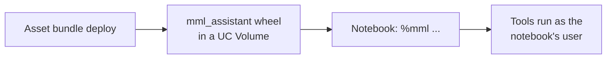

The trade-off is that there is no chat UI. The package is written as a library, not as a
notebook, so if those on-behalf-of scopes arrive it can sit behind an App unchanged.

## Teaching it the codebase without leaking the codebase

Knowledge answers come from retrieval, not from a model that memorized the repos. An ingestion
job, running entirely on Databricks, reads a curated set of material, each repo's top-level docs,
the knowledge profiles we wrote by hand, the architecture decks, the transcripts, chunks it,
embeds it, and syncs it into a Vector Search index. At question time the agent retrieves the
relevant chunks and answers from them, with citations, so every claim is traceable to a source.

The job is scheduled daily, but that schedule is less than it sounds. The dev deployment uses the
bundle's development mode, which pauses every schedule, so the daily run does not happen there.
And the job only re-reads what is already in the Volume; new material gets there when someone
runs the staging script from a laptop with local clones of the repos. In practice the knowledge
base is as current as the last time that happened.

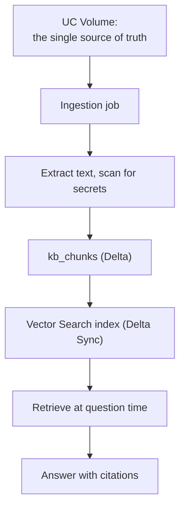

The subtle part is the source code. We genuinely wanted the assistant to be able to say "the
class that handles scoring dispatch is here, with this signature," but we did not want raw source
sitting in an index. So the ingestion never sees raw code. Instead, a staging step turns every
source file into a structural summary, the symbols, the classes, the function signatures, plus a
one-line purpose, and only that summary is indexed. The assistant can point you at the file
behind a traceback and tell you what lives in it, without a single line of actual implementation
ever reaching the knowledge base.

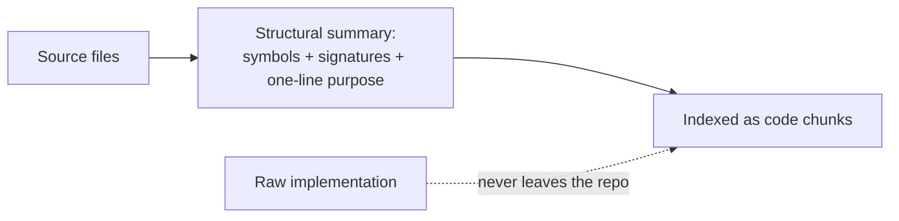

This is the same instinct as the grant trap and the tenant filter from earlier parts: decide
exactly what is allowed to cross a boundary, and build the mechanism so the disallowed thing
cannot cross even by accident.

## Diagrams are knowledge too

A detail we are quietly proud of: the architecture decks are full of diagrams, and a diagram is
often where the real design lives, the box-and-arrow picture that the prose around it never quite
restates. So at ingestion time, an in-tenant vision model captions every embedded diagram, and
those captions become searchable chunks of their own. Ask how two services talk to each other and
the answer can come from a picture in a deck, because that picture was turned into text the
retriever can find.

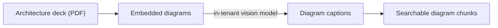

It would have been easy to skip the images and index only the text. Captioning them inside the
tenant, with a model that never phones home, meant the most information-dense part of the decks
stopped being invisible to the assistant.

## Finding the right chunk

Retrieval is a hybrid query, semantic and keyword together, because our questions are full of
exact identifiers, a field name, a run id, an exception class, that embeddings tend to blur. The
first version then reranked the candidates by asking the chat model to score each one. That
worked, but it cost one extra model call per search, and its cost and quality shifted every
time we changed the agent's model.

Vector Search, now AI Search, has a built-in reranker: a cross-encoder applied inside the same
query. We ran both on the same evaluation with the same agent. Knowledge correctness was 0.85
for both, scores on unseen failures were identical, and known failures were within noise. Same
quality, one fewer model call per search, and retrieval no longer depends on which chat model
we pick. The homegrown reranker is still there behind a setting; it is just not the default.

## Tools that run as you

Knowledge is the easy half. The half that makes this more than a documentation search is that the
agent can reach into live systems: list your failed runs, pull a run's error and logs from any of
our workspaces, search the app telemetry, check a model's real configuration, check which library
builds a cluster had, run a read-only SQL query, hand a data question to Genie, even re-run a
regression model. And every one of those actions runs as the person asking, on the notebook's
own identity, never on a shared one.

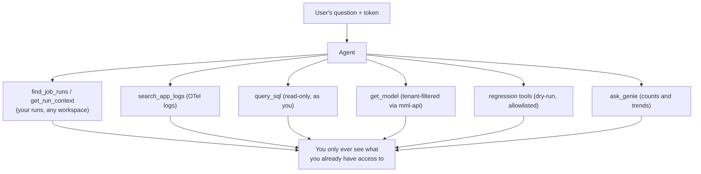

This is the on-behalf-of identity story from part one, cashed in. Because the tools act as the
caller, the access question answers itself: you see your jobs, your logs, your tenant's models,
and nothing else, not because the assistant filters them afterward, but because the underlying
systems refuse to show one user another user's data in the first place. There is deliberately no
service-principal fallback for reads. An ambient service principal would be able to see across
users, so rather than fall back to it, the tools fail closed and refuse to run.

## The identity gate, enforced twice

The rule that the sensitive tools require a real per-user identity is not a comment in the docs;
it is a declared property on each tool, and it is checked in two places. When the agent decides
which tools even to offer, the per-user tools are hidden from any caller that lacks a human
identity. And then again, at the moment a tool actually runs, the identity is re-checked, so even
if something slipped through, the execution refuses.

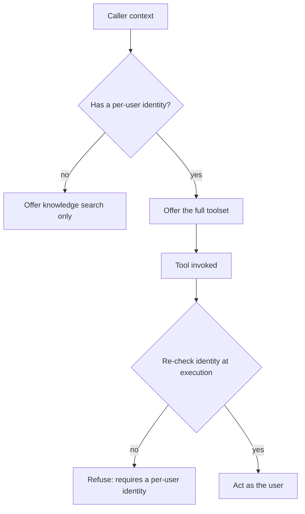

Checking the same thing twice looks redundant until you remember what it is guarding: the schema
gate is about what the model is tempted to call, and the execution gate is about what actually
happens. One is advice to the agent, the other is a lock on the door. Defense in depth here is
cheap, and the thing it protects, never reading one user's data as another principal, is exactly
the kind of invariant you do not want resting on a single check.

## One place to read every workspace's logs

The platform runs in six workspaces: dev, test and prod, for two lines of business. A failed run
in one of them is invisible to the Jobs API of the others. Part four showed how work gets routed
across workspaces; the assistant has to read the results of that work, wherever it ran.

Two pieces of plumbing make that possible, and neither was built for the assistant. Every MML
cluster policy pins log delivery to one shared Unity Catalog Volume, a folder per workspace and a
folder per cluster. And the org's system tables are exposed as views that list every job run in
every workspace, with the cluster it ran on. So for a run elsewhere, the assistant looks the run
up in the views, finds its cluster, and reads that cluster's driver logs from the Volume, as the
user. Unity Catalog grants decide what they see, same as everywhere else.

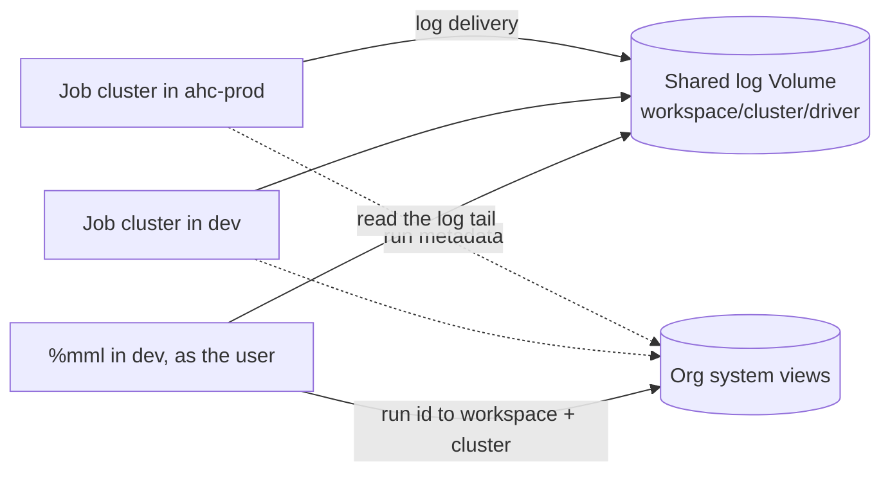

Building it surfaced three caveats worth stating. Volume grants are all or nothing, so anyone who
can read the log Volume can read every workspace's driver logs, prod included. The assistant
does not widen that, but whoever owns the grant should know what it hands out. A few older
cluster policies still deliver logs to a different path, so their runs come back with no logs
until the policies are aligned. And the views sit on system tables whose shape we do not control.
When one of them changed, the view we used for a run's job name failed on every query, and with
it every cross-workspace diagnosis. The lookup now takes the name from the run timeline view, and
a failed name lookup no longer fails the whole diagnosis.

## Logs in labelled sections

The first log reader looked for two things, Python tracebacks and Py4J errors, and filed every
other Java exception as background noise. Then we showed the assistant to a small internal
team, someone handed it a prod run that had died without a Python error, and it answered, in
effect, "cause unknown, check the logs." The cause was in the logs. Spark had aborted the job
after one task failed four times, because new executors kept timing out while downloading a
240 MB jar from the driver: 900 executors lost and nearly 3,000 failed jar transfers. The reader
had filed all of it under noise, and the prompt told the model to ignore noise.

Before fixing it we wanted to know what else we were dropping, so we scanned the complete driver
logs of eleven failed runs across our workspaces, about 4 GB. Run on Databricks, next to the
data, the scan took 79 seconds; the same read to a laptop did not finish. Two findings reshaped
the reader:

- Reading only the last 8 MB of each file was fine. Every useful line was in that tail.
- For seven of the eleven runs the exception was not in the driver logs at all. A notebook
  task's exception goes to the run's output, which only its own workspace can show. The logs just
  showed the cluster shutting down afterwards.

So the reader now returns labelled sections instead of one list of errors, and the prompt says
how to read each one:

| Section | What it holds |
| --- | --- |
| `failure` | Python tracebacks, Py4J errors and Spark job aborts, the first one and the latest |
| `spark` | executors and tasks lost and why, jars the driver failed to send, the tail of the executor named in the abort |
| `app_errors` | ERROR lines logged by our own code, for example an mml-api timeout |
| `lifecycle` | how it ended: cluster termination, preemption, out of memory, kills |
| `other_jvm_errors` | what is left, with known platform noise removed |
| `init_scripts` | init-script errors, read only when nothing else failed |
| `coverage` | which files were read, which only from the tail, what was dropped |

For runs in our own workspace it also includes the run output's full traceback, cleaned up.
For runs elsewhere, when the logs only show a shutdown, the assistant says exactly that, links to
the run in its own workspace, and does not name a cause. On that prod run, the share of expected
facts in the answer went from a third and two thirds on two attempts to all of them, both times.

## Ground truth beats a plausible guess

Here is the design decision that most separates this from a generic chatbot. When you ask why a
job failed, the tempting thing for any language model to do is read the error message and narrate
a plausible story about it. That is precisely what we did not want, because error messages lie,
or at least mislead, all the time. A log can say one thing while the real model config says
another.

So the diagnosis path is built to prefer evidence over narration. The assistant can fetch the
model's actual configuration from the tenant-filtered API, read the real app logs out of the
warehouse, and look at the structure of the source file named in the traceback, and when the
evidence contradicts the surface error, it is instructed to name the corrected cause, not the
one the log implied.

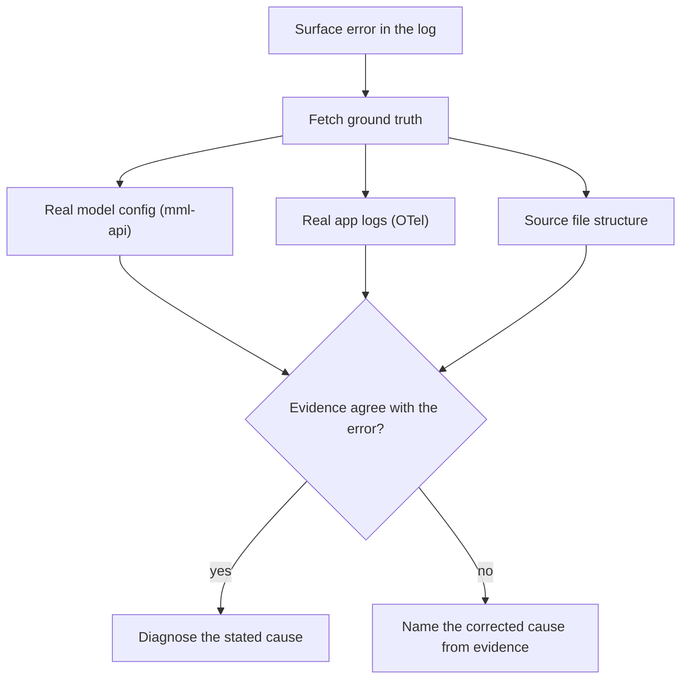

The concrete case that taught us this: a log complained that a model was missing its training
ranks, but the model's real config, fetched live, showed the rank statistics populated. The ranks
existed. The true problem was elsewhere, and an assistant that trusted the log would have sent the
user chasing a non-problem. Verifying against ground truth is the whole difference between a tool
a data scientist trusts and one they learn to ignore.

Some of this is enforced in code rather than requested in the prompt. Confidence is capped at
Medium unless a ground-truth check actually succeeded. A diagnosis with no check is sent back once
to run one, and error advice given without searching the runbook is sent back to search it.
Links to URLs that no tool returned are stripped, and a citation of a doc path that no search
returned is marked as such in the answer.

## Treating tool output as data, not instructions

Because the assistant reads model fields and job logs and feeds them back into a language model,
there is a prompt-injection surface staring right at us. A model name, a log line, a notebook
parameter could contain text that tries to steer the agent. So the agent treats everything that
comes back from a tool as data to reason about, never as instructions to follow. A log line is
evidence, not a command, no matter what it says.

This is the same wariness the whole series has carried about trusting inputs, the open-redirect
guard on the bounce endpoint, the tenant check on every write, applied now to the one place where
untrusted text and a language model meet. The boundary is just more subtle, because the attack
would be phrased in English rather than a URL.

## The eval that flattered us

There is an evaluation harness: real questions with reference answers, run through the real
agent, scored by an LLM judge one expected fact at a time, so an answer with two of three facts
scores 0.67. The first time we pointed it at failed-job questions, a few days of work took the
score from 0.27 to 0.81, and we were pleased for about an afternoon.

Every one of those failures was already written up in our runbook of solved problems, which the
assistant searches. A score of 0.81 meant it could find and apply fixes we had already written
down. That is useful, and it is a training-set score. It says nothing about the failure nobody
has seen yet, which is the only reason to ask an assistant instead of reading the runbook.

The noise lesson from the first version still holds. With a handful of cases the same model moves
about 0.1 between runs, so every comparison in this post was run at least twice, concurrently,
and smaller moves are treated as noise.

## Asking it as of a minute in the past

Measuring the unseen case honestly means asking about a failure as of the moment it happened,
before anyone had solved it, with only the knowledge that existed then. So every chunk in the
knowledge base carries a validity window. Repo docs and code maps come from each repo's git
history, one version per change. Runbook entries are valid from the minute the fix was written
up. Normal questions see only what is current; the evaluation can ask as of any past minute and
get exactly that minute's knowledge base. The index holds 1,685 dated chunks, 978 of them current.

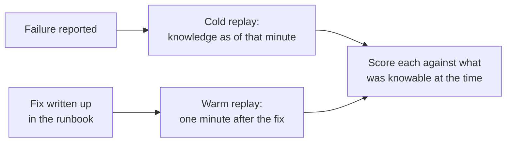

We mined ten real failures from past debugging sessions, each with when it was reported and when
it was fixed, and replay each one twice. Cold, as of the report, scored on what a good engineer
could reach from the error alone: the right area, the right kind of cause, the checks to run.
Warm, a minute after the fix was written up, scored on the specific cause and fix. Warm minus cold
is the measured value of writing fixes down. The oldest six are a validation set we tune on; the
newest four are a test set we only run at release, and a unit test fails if any of them leaks into
the prompt or into a runbook entry dated before it happened.

Replays only get the knowledge search tool. The live tools would see today's state, a grant added
since, a model retrained since, and would either mislead or leak the answer. So cold scores are a
lower bound on what the assistant does with a failure while it is still happening.

## Grading the whole loop on real failures

The first version of this post ended with a confession: the harness exercised retrieval, not the
tool-calling loop, so the scenario we built the assistant for was unmeasured. That now has a fix,
a live suite of real failed runs diagnosed with every tool, against facts we verified by hand
from each run's output and complete logs: a Delta concurrent-write conflict, a class missing on
the executors, a cluster policy the job was not allowed to use, the prod dependency timeout, and
a run in another workspace whose logs show nothing but a shutdown, where the right answer is "I
can't tell from here, open it in its own workspace."

It is small, five cases, and runs age out of the Jobs API after sixty days, so it has to be
refreshed. But it is the first measurement of the thing we actually ship, and it is what caught
the log reader's blind spot and then showed the fix worked.

## When the docs are wrong

One live-suite answer said the mml-jvm build docs claim Spring Core is bundled inside the jar. We
assumed the model had made that up and added a guardrail: never say a doc says something unless a
tool returned that text, and mark any citation of a path no search returned. Then we checked. The
doc does say it. The doc is wrong: the build has no shading step, the jar contains no Spring
classes, and the run in question failed precisely because Spring was missing on the executors.

So the assistant had not hallucinated. It had faithfully repeated a stale architecture doc, which
is a different failure with a different fix. The guardrail is still worth having, but no prompt
rule catches a source that is confidently wrong. A retrieval-grounded assistant is exactly as
accurate as the docs it retrieves, and building one turned out to be an effective way of finding
the docs that have drifted from the code.

Fixing a doc is also harder than it sounds. A later refresh of the platform docs added a note that
the build has no shading step and does not produce a fat jar, and kept the line saying Spring
Core is bundled. At the time of writing the doc says both. An assistant reading it has two
contradictory sources and no way to know which one is true; only the build can settle that.

## Which model, and the line we moved

The first version of this post opened with a hard rule: nothing leaves the tenant. Embeddings,
chat, reranking and the vision model were all Databricks-hosted. That rule shaped a lot of good
decisions and we have kept most of it. We relaxed it for one component, the chat model that drives
the agent, because the evaluation made the cost of keeping it concrete.

Same evaluation, same settings, four agent models (judge: Llama 3.3 70B at the time; knowledge is
correctness, the other columns are the share of expected facts found):

| Agent model | Knowledge | Known failures | Unseen, cold | After the fix, warm | Hosting |
| --- | --- | --- | --- | --- | --- |
| Llama 3.3 70B | 0.50 | 0.73 | 0.28 | 0.70 | Databricks-hosted |
| GPT-OSS 120B | 0.90 | 0.86 | 0.44 | 0.86 | Databricks-hosted |
| Claude Sonnet 5.5 | 0.95 | 0.93 | 0.69 | 0.94 | Partner model |
| Claude Opus 5.5 | 0.90 | 0.93 | 0.72 | 0.97 | Partner model |

The cold column is the one that matters. The Databricks-hosted models find between a quarter and
under half of what was knowable about a new failure; the Claude models find around 70%, and Opus
found 83% on the four test cases we never tuned on. On the live suite, Sonnet matched Opus within
noise. GPT-OSS 120B, the strongest hosted option, scored under 0.5 there: it found the right
evidence, quoted the Spark abort and the failing jar, and then declined to commit to a cause.

So the agent now defaults to Claude Opus 5.5, served through the Foundation Model API, and the
evaluation judge to Claude Sonnet 5.5, because the 70B judge kept marking correct answers wrong.
Those requests go to the model provider under Databricks' terms, which is a real change to what we
can say about data leaving the tenant. Everything else is unchanged: embeddings, search, the
reranker and diagram captions stay Databricks-hosted, every tool still runs as the user, and one
setting switches the agent back to a hosted model wherever everything must stay in-tenant. We
would rather state that trade plainly than keep a slogan the numbers no longer support.

## What a live demo taught us

Two questions from the internal demo are now permanent sections of the demo notebook, because both
went wrong live.

"How many jobs failed recently with `'str' object has no attribute 'columns'`?" The assistant sent
it to Genie, which is sensible for a counting question, and Genie timed out. It could not have
answered anyway: the system tables record a termination code, not the error text. Counting by
error text now goes through the Jobs API, reading each failed run's error, and the answer comes
with the runbook's known cause and fix.

"Why did this job fail 124337049826774?" was the prod run from the log section above.

The third lesson was quieter. The demo notebook did not set a model, so it ran on the old default,
and the trace did not record which model answered; we worked it out from response timings. Every
trace is now tagged with the agent model, the reranker and the package version. When a demo goes
wrong, the first question is what actually ran.

## Why every earlier part shows up here

Step back and the assistant is a tour of the whole series. Part one is why it is not an App:
on-behalf-of identity decided where it could live, and it lives where the user's identity already
is. It re-runs regression models through the capped, per-kind queue from part two. It checks model
ground truth through the tenant-filtered API from part three, so a user only ever sees their own
tenant's models. It reads the OpenTelemetry logs from part four, and it reaches across workspaces
through the same shared log Volume and system views that make cross-workspace operation
observable at all.

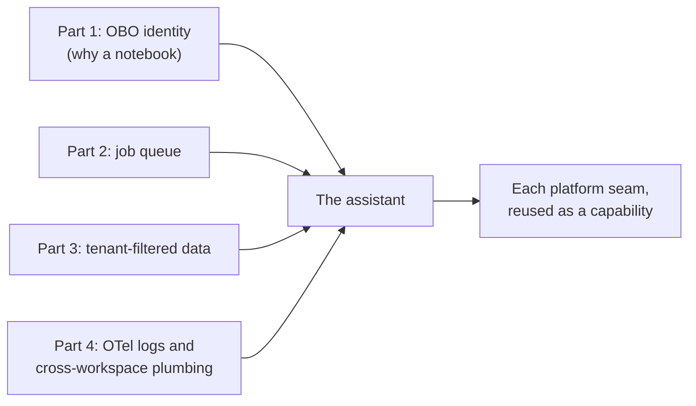

None of the assistant's best properties are things we invented for it. They are things the
platform work already paid for. The per-user access was built for the API; the assistant inherited
it. The telemetry tables and the shared log Volume existed for debugging; the assistant reads them.
The queue was built for training runs; the assistant reuses it for regressions. That is the quiet
argument of this whole epilogue: do the unglamorous platform work well, and the impressive thing on
top gets much of its integrity for free.

## Where it is going

It runs in dev today. Rolling it out beyond dev means a shared catalog and Volume for the index and
the wheel, permissions for everyone who should use it, and rate limits on the Claude endpoint,
which today only has usage tracking. The evaluation needs more held-out cases before a single
number means much, and the live suite needs a steady supply of fresh failures as old runs age out.
The stale docs it surfaces need fixing at the source, not working around in the prompt.

Two of those problems have a draft design. The first is keeping the knowledge base current: one
knowledge base per environment, refreshed by each repo's own CI when it pushes, instead of by a
schedule or a laptop. The second is learning from fixes: when a merged pull request references
a failure the assistant diagnosed, a judge compares the assistant's suggestion with what was
actually merged, and records the verdict on the original trace. Fixes that are not code changes
land in the runbook instead. Neither is built yet. And if
on-behalf-of scopes ever cover everything the tools need, a hosted UI becomes possible without
giving up the user's identity.

The shape is right, and the reasons it is right are the reasons the first four parts exist. An
assistant that only ever acts as you, that prefers evidence to a confident guess, that reads the
same logs and tables an engineer would, and that is measured on the failures it has not seen yet,
is the thing the platform was quietly making possible the whole time. The numbers say it gets
about seven in ten of the knowable facts about a new failure. That is not a replacement for an
engineer. It is a good first ten minutes, as the user, with the evidence attached.
